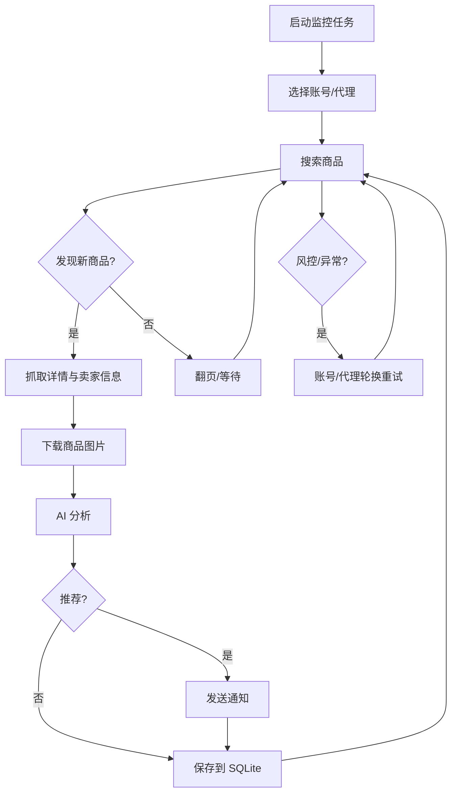

# 闲鱼智能监控系统

[中文] ｜ [English](README_EN.md)

基于 Playwright + 多模态 AI 的闲鱼商品监控机器人：多任务并发、AI 判断、多渠道通知、完整 Web 管理界面。

## 功能

- **Web 管理**：任务、账号、Prompt、运行日志、结果浏览一站式操作
- **AI 判断**：自然语言创建任务，多模态模型分析商品图文
- **多任务并发**：每个任务独立配置关键词、价格、筛选条件与 Cron
- **高级筛选**：包邮、发布时间范围、省/市/区三级区域
- **多渠道通知**：ntfy / Bark / 企业微信 / Telegram / PushPlus / Gotify / Webhook
- **账号与代理轮换**：多账号绑定、代理池、失败熔断
- **Docker 部署**：一键启动，SQLite 单库存储

## 快速开始（Docker）

```bash
git clone https://github.com/KD-Leon/xianyu_ai && cd xianyu_ai
cp .env.example .env
vim .env                       # 至少填写 AI 的三项配置
docker compose up --build -d
docker compose logs -f app
```

打开 `http://127.0.0.1:8000`。镜像已内置 Chromium，无需在宿主机安装浏览器。

> `docker-compose.yaml` 默认使用的是上游镜像，直接 `up -d` 会拉到旧代码。请用 `--build` 本地构建，或等本仓库的 Actions 构建完成后，把 `APP_IMAGE` 设为 `ghcr.io/kd-leon/ai-goofish:latest`。

### 最少配置

| 变量 | 说明 |
|---|---|
| `OPENAI_API_KEY` / `OPENAI_BASE_URL` | AI 接口凭据与地址 |
| `OPENAI_MODEL_NAME` | 必须支持图片输入（多模态） |
| `WEB_USERNAME` / `WEB_PASSWORD` | Web 登录账号；默认账号 `admin`，首次部署请修改密码 |

其余配置见 `.env.example`。

### 第一次使用

1. 登录 Web UI。
2. 进入「闲鱼账号管理」，用 [Chrome 扩展](https://chromewebstore.google.com/detail/xianyu-login-state-extrac/eidlpfjiodpigmfcahkmlenhppfklcoa) 导出登录态 JSON 并粘贴，文件保存到 `state/`。
3. 进入「任务管理」，新建任务并绑定账号后运行。

## 本地开发

需要 Python 3.10+、Node.js 20+、Playwright Chromium。

```bash
cp .env.example .env
./start.sh        # 检查前置条件、安装依赖、构建前端、启动后端
```

手动启动：

```bash
python -m src.app                                  # 后端 :8000
cd web-ui && npm install && npm run dev            # 前端（代理 /api、/auth、/ws）
```

数据库默认 `data/app.sqlite3`，首次启动自动建表，并尝试从旧的 `config.json`、`jsonl/`、`price_history/` 导入一次数据。

### 测试

```bash
pytest                              # 后端；live 用例默认跳过
cd web-ui && npm run build          # 前端类型检查 + 构建
```

CI 会同时执行这两项。

## 配置要点

- `RUN_HEADLESS`：无头模式；容器内保持 `true`
- `AI_REQUEST_TIMEOUT_SECONDS`：单次 AI 请求超时，默认 180 秒
- `WEB_AUTH_ENABLED`：是否要求登录后访问 `/api/*`，默认 `true`
- `TASK_FAILURE_THRESHOLD` / `TASK_FAILURE_PAUSE_SECONDS`：连续失败熔断与暂停时长
- `PROXY_ROTATION_*`：代理池与轮换策略
- `PRICE_SNAPSHOT_RETENTION_DAYS`：价格快照保留天数，默认 90

### Web 认证

登录成功后服务端写入 HttpOnly Cookie，`/api/*` 与 `/ws` 凭 Cookie 校验，`/health` 保持公开。

- 脚本直连 API：先 `POST /auth/status` 获取 Cookie 再请求
- 不需要认证：设置 `WEB_AUTH_ENABLED=false`

## 工作流程



## 注意事项

- 请遵守闲鱼用户协议与 robots.txt，控制请求频率，避免账号受限。
- 本项目仅供学习与技术研究，请勿用于非法用途。
- 采用 [MIT 许可证](LICENSE)，按「现状」提供，不提供任何担保；详见 [免责声明](DISCLAIMER.md)。

## 来源与致谢

本项目基于 ai-goofish-monitor（原作者 dingyufei615，MIT 协议）及其社区版本
[Usagi-org/ai-goofish-monitor](https://github.com/Usagi-org/ai-goofish-monitor)。
同时感谢 [superboyyy/xianyu_spider](https://github.com/superboyyy/xianyu_spider)、
[LinuxDo](https://linux.do/) 社区以及 @jooooody 的脚本贡献。
