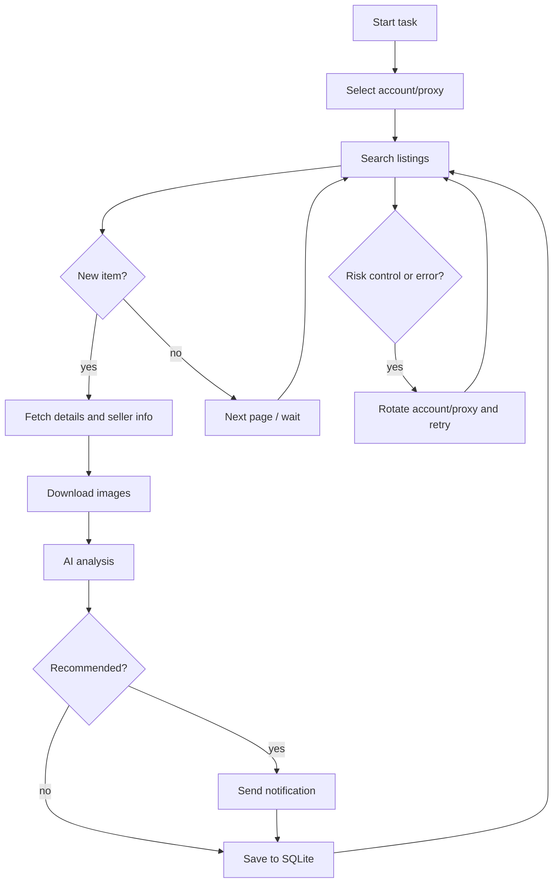

# Xianyu Intelligent Monitor Bot

[Chinese](README.md) ｜ [English]

A Xianyu (Goofish) product monitoring bot built on Playwright and multimodal AI: concurrent tasks, AI judgement, multi-channel notifications, and a full web UI.

## Features

- **Web UI**: manage tasks, accounts, prompts, logs and results in one place
- **AI judgement**: create tasks from natural language; multimodal models analyse listings and images
- **Concurrent tasks**: per-task keywords, price range, filters and cron schedules
- **Advanced filters**: free shipping, publish time, province/city/district
- **Notifications**: ntfy / Bark / WeCom / Telegram / PushPlus / Gotify / Webhook
- **Accounts and proxies**: per-task account binding, proxy pool, failure circuit breaker
- **Docker**: one-command deployment with a single SQLite database

## Quick start (Docker)

```bash
git clone https://github.com/KD-Leon/xianyu_ai && cd xianyu_ai
cp .env.example .env
vim .env                       # at least set the three AI variables
docker compose up --build -d
docker compose logs -f app
```

Open `http://127.0.0.1:8000`. Chromium is bundled in the image; no host browser needed.

> The default image in `docker-compose.yaml` points to the upstream project, so a plain `up -d` pulls older code. Use `--build` to build locally, or set `APP_IMAGE` to `ghcr.io/kd-leon/ai-goofish:latest` after this repository's Actions build has run.

### Minimum configuration

| Variable | Description |
|---|---|
| `OPENAI_API_KEY` / `OPENAI_BASE_URL` | AI credentials and endpoint |
| `OPENAI_MODEL_NAME` | Must support image input (multimodal) |
| `WEB_USERNAME` / `WEB_PASSWORD` | Web login; default user is `admin`, change the password before deploying |

See `.env.example` for everything else.

### First run

1. Log in to the web UI.
2. Open **Accounts**, export the login state with the [Chrome extension](https://chromewebstore.google.com/detail/xianyu-login-state-extrac/eidlpfjiodpigmfcahkmlenhppfklcoa) and paste the JSON; it is stored under `state/`.
3. Open **Tasks**, create a task, bind an account and run it.

## Local development

Requires Python 3.10+, Node.js 20+ and Playwright Chromium.

```bash
cp .env.example .env
./start.sh        # checks prerequisites, installs deps, builds the frontend, starts the server
```

Or manually:

```bash
python -m src.app                                  # backend on :8000
cd web-ui && npm install && npm run dev            # frontend (proxies /api, /auth, /ws)
```

The database defaults to `data/app.sqlite3`. On first start it is created automatically and legacy `config.json`, `jsonl/` and `price_history/` data is imported once.

### Tests

```bash
pytest                              # backend; live tests are skipped by default
cd web-ui && npm run build          # frontend type check + build
```

CI runs both.

## Configuration highlights

- `RUN_HEADLESS`: headless mode; keep `true` in containers
- `AI_REQUEST_TIMEOUT_SECONDS`: per-request AI timeout, default 180s
- `WEB_AUTH_ENABLED`: require login for `/api/*`, default `true`
- `TASK_FAILURE_THRESHOLD` / `TASK_FAILURE_PAUSE_SECONDS`: failure circuit breaker
- `PROXY_ROTATION_*`: proxy pool and rotation
- `PRICE_SNAPSHOT_RETENTION_DAYS`: price snapshot retention, default 90 days

### Web authentication

After login the server sets an HttpOnly cookie; `/api/*` and `/ws` are validated against it, while `/health` stays public.

- Calling the API from scripts: `POST /auth/status` first, then reuse the cookie
- Disabling auth: set `WEB_AUTH_ENABLED=false`

## Workflow



## Notes

- Follow Xianyu's terms of service and robots.txt; keep request rates low to avoid account restrictions.
- This project is for learning and technical research only. Do not use it for illegal purposes.
- Released under the [MIT License](LICENSE), provided "as is" without warranty. See also [DISCLAIMER](DISCLAIMER.md).

## Credits

Based on ai-goofish-monitor (original author dingyufei615, MIT) and its community fork
[Usagi-org/ai-goofish-monitor](https://github.com/Usagi-org/ai-goofish-monitor).
Thanks also to [superboyyy/xianyu_spider](https://github.com/superboyyy/xianyu_spider),
the [LinuxDo](https://linux.do/) community and @jooooody for their script contributions.
